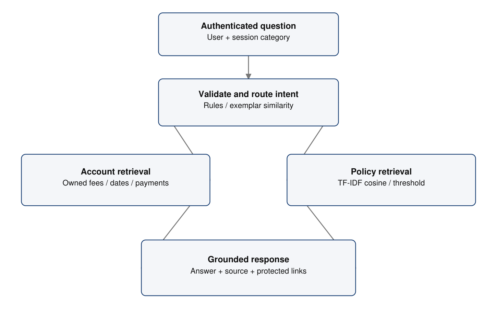
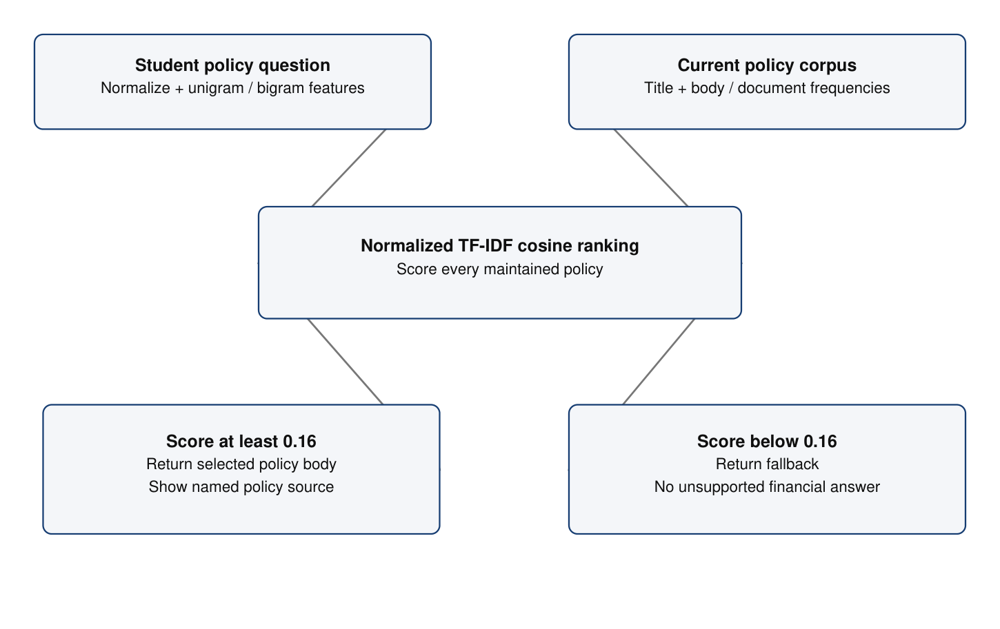
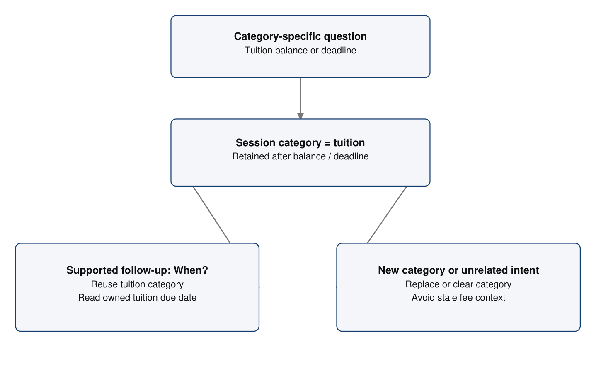
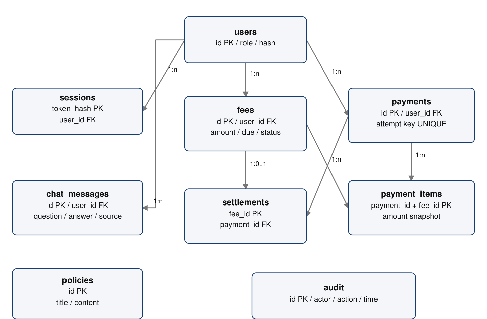

# NEC FEE PORTAL MANAGEMENT SYSTEM WITH NLP-BASED STUDENT ASSISTANCE CHATBOT

**SYED SUFYAN M - 2403957610421048**

23CS23E - AI TOOLS FOR NATURAL LANGUAGE PROCESSING

Bachelor of Engineering in Computer Science and Engineering

National Engineering College | October 2026

## Chapter 1 - INTRODUCTION

### 1.1 Introduction and problem statement

NEC Fee Assist is an NLP-based student assistance chatbot supported by a college fee portal. Its primary purpose is to interpret a student's question and return the relevant fee information in natural language. Students can ask about their outstanding balance, fee deadlines, payment history, receipts and fee policies without manually searching through several portal screens. The fee portal supplies the authenticated account records required for reliable answers.

College fee information contains both structured and unstructured knowledge. Amounts, dates and payment states are stored as database records, while payment instructions, refund guidance and support policies are maintained as text. A useful conversational assistant must distinguish these knowledge types. It should calculate a balance from the student's own records, retrieve a policy from the knowledge base and avoid inventing facts when information is unavailable.

#### Problem statement

A conventional portal can display fee records, but it cannot interpret questions such as "How much do I owe?" or "When is my tuition fee due?". Students must understand the interface and accounting terminology before locating the answer. The project addresses this interaction gap through natural language intent routing, fee-category recognition, lexical information retrieval and source-grounded answer construction.

#### Proposed solution

The assistant combines explicit language rules with unigram/bigram TF-IDF and cosine similarity. Account questions use predefined, authenticated database reads. Policy questions search administrator-maintained text. Limited session context supports short follow-ups, and low-relevance questions receive a fallback response. The interface presents the answer and its source. Fee management provides the application context; the NLP pipeline is the central academic focus.

### 1.2 Contribution, scope and motivation

| NLP contribution | Purpose |
| --- | --- |
| Hybrid intent routing | Combine clear keyword rules with similarity against intent examples. |
| Word and phrase representation | Use unigrams and bigrams to represent fee questions and policies. |
| Policy retrieval | Rank maintained knowledge text using smoothed TF-IDF cosine similarity. |
| Fee-category context | Resolve supported follow-up deadline questions within a session. |
| Grounded answer construction | Compose financial answers from owned account records. |
| Fallback and source attribution | Expose unsupported queries and identify the source of answers. |

The system is an explainable classical NLP application. Its AI contribution lies in language interpretation and knowledge retrieval, rather than a newly trained deep learning model. The design runs offline, requires no external language-model credentials and permits direct inspection of the features and routing rules. This makes it suitable for demonstrating core NLP concepts in the course 23CS23E - AI Tools for Natural Language Processing.

The supporting portal includes student and administrator sign-in, illustrative fee allocations, simulated payment outcomes, transaction history and demonstration PDF receipts. These workflows supply realistic data for evaluating conversational answers. The chatbot has no payment or record-editing tool; it only reads authorized records and policies.

The implemented scope is English lexical retrieval with narrow fee-category context. Transformer embeddings, generative LLMs, speech, OCR, multilingual queries and live gateway integration are future extensions. Payment amounts and dates are illustrative. The project is a separate local demonstration and does not connect to the official NEC ERP or the read-only reference portal database.

## Chapter 2 - OBJECTIVES

### 2.1 NLP and chatbot objectives

| Objective | Expected behavior |
| --- | --- |
| Understand fee questions | Route balance, deadline, history, receipt, profile and help questions. |
| Recognize fee categories | Identify tuition, examination, library, transport and hostel wording. |
| Represent language numerically | Build sparse unigram/bigram vectors using sublinear TF-IDF. |
| Retrieve fee policies | Select relevant maintained policy text using cosine ranking. |
| Support conversational continuity | Use the retained category for supported short follow-up queries. |
| Keep financial answers grounded | Read amounts and payment states from authenticated account records. |
| Handle unsupported questions | Return a fallback when the policy similarity is below threshold. |
| Make answers traceable | Show account or policy source labels and protected receipt links. |
| Evaluate actual behavior | Record route results, errors and per-intent diagnostic metrics. |

#### Supporting system objectives

The fee portal should supply consistent account records, isolate student data and retain simulated payment attempts. Administrators should maintain the policy knowledge base and demonstration fee allocations. Receipts must reflect completed simulated payments. These functions support the chatbot evaluation rather than replace the NLP objectives.

Assessment considers correct routing, useful retrieval, grounded account values and transparent failure behavior. Similarity scores are ranking values, not calibrated confidence percentages. The report distinguishes a small diagnostic evaluation from an independent benchmark and does not infer general language understanding from successful example questions.

## Chapter 3 - SYSTEM DESCRIPTION & NLP APPROACH

### 3.1 Conversational system and supported intents

The student submits a question through the Fee assistant screen. The server first identifies the signed-in account, validates the question and loads its fee-category context. Intent routing then selects a fixed account operation or the policy retrieval route. The resulting answer is returned with an intent, source, ranking score and optional receipt links; the interface displays the answer and a concise source label.

| Intent | Example question | Answer source |
| --- | --- | --- |
| Balance | How much are my pending fees? | Owned pending fee rows |
| Deadline | When is my tuition fee due? | Owned pending fee dates |
| History | Show my payment history | Owned payment attempts |
| Receipt | Download my receipt | Owned completed payments |
| Profile | What is my register number? | Authenticated public profile |
| Help | What can you help with? | Configured assistant help |
| Policy | What happens if payment fails? | Maintained policy text |
| Fallback | Unrelated unsupported question | No matching record |

Account intents are deliberately separated from text retrieval. A tuition balance cannot be inferred from a generic policy sentence, and a receipt link is offered only when a completed payment exists. All account reads use the authenticated owner. The question does not grant access to another student even if it contains another register number.

The assistant is integrated into the student portal but does not initiate a transaction. Student payment controls and administrator mutations remain separate authenticated actions. This permits useful conversation without treating arbitrary language as authority to change financial state.

### 3.2 Knowledge corpus and text processing

The policy corpus initially contains nine short documents: payment methods, late payment and fines, refunds, scholarships, receipt download, failed/cancelled payments, partial payments/installments, accounts support and privacy. Each searchable document joins the policy title and body. Titles provide strong topic cues, while the body contains the answer shown to the student.

#### Text-processing stages

```text
Question / policy title + content
  -> lowercase normalization
  -> [a-z0-9]+ token extraction
  -> explicit stop-word removal
  -> unigram and adjacent-bigram counts
  -> sublinear TF-IDF weighting
  -> L2 normalization
  -> cosine ranking
```

The stop-word list removes common function words and routine conversational wording. Numeric tokens remain available. Adjacent bigrams are formed after stop-word removal, so phrases such as "payment history" and "due date" can influence ranking. Features outside the current document vocabulary are ignored in the query representation.

Policy vectors are reconstructed from the current database rows for each question. An administrator edit is therefore searchable without a restart. The small corpus makes this simple design practical. A larger institutional corpus would benefit from cached indexes, controlled policy versions and separate evaluation data.

No stemming, lemmatization, spelling correction or semantic embedding model is implemented. Consequently, vocabulary overlap and phrase coverage affect retrieval. The diagnostic evaluation later in the report identifies failures caused by these limits rather than presenting the retrieval engine as unrestricted language understanding.

### 3.3 Context handling and grounded responses

#### Fee-category extraction

The assistant recognizes tuition, examination, hostel, transport and library. The word "exam" maps to examination. For balance and deadline intents, the recognized category filters the account rows. A general balance question has no category filter, so it returns the full outstanding amount. An unassigned category produces an explicit no-record response.

#### Short follow-up resolution

After a category-specific balance or deadline question, that category is retained on the session. Supported short follow-ups such as "When?", "Due date?" and "Last date?" reuse it. Other intents clear the category. Persisted chat history is used to display earlier exchanges; it is not a general semantic memory or a cross-student conversation store.

| Conversation turn | Resolved operation |
| --- | --- |
| How much is my tuition fee? | Balance route; category = tuition |
| When? | Deadline route; reuse tuition category |
| How much are my pending fees? | Balance route; remove category filter |
| What happens if payment fails? | Policy retrieval; clear fee-category context |

#### Answer grounding

A balance is formatted from the sum of pending integer-paise fee rows. A deadline answer uses recorded due dates. A history answer uses payment attempts. A receipt answer links to an owner-protected download. A policy answer returns the selected maintained policy body. If the policy score is insufficient, the assistant returns a fallback instead of inventing a date, fee or payment confirmation.

This design makes the source of each answer inspectable. It reduces unsupported generation by using templates and extraction, while still depending on correct intent routing and relevant policy matching. Grounded content does not automatically imply that the question was interpreted correctly.

## Chapter 4 - AI & NLP PIPELINE ARCHITECTURE

### 4.1 NLP pipeline architecture


Figure 4.1: NLP routing between authenticated account retrieval and policy retrieval.

The pipeline begins with the authenticated question and retained fee category. Clear language triggers route directly to an account intent or policy search. Less explicit questions are compared against intent exemplar text. The chosen route determines whether the answer is derived from structured records or a ranked policy document.

| Pipeline stage | Role |
| --- | --- |
| Identity and validation | Resolve the account; accept a nonempty question up to 1000 characters. |
| Intent and entity resolution | Identify the operation and an optional fee category. |
| Knowledge access | Read owned account rows or current policy documents. |
| Response construction | Format record values or return maintained policy text. |
| Persistence and presentation | Store the exchange and display the source-grounded answer. |

The language component is isolated in app/nlp.py; account and policy operations are defined in app/service.py. This separation allows the NLP behavior to be evaluated without adding language-driven write operations. The browser transports the question and displays the response.

### 4.2 Policy retrieval and answer grounding


Figure 4.2: Policy vectorization, similarity selection and fallback decision.

For a policy question, the current policy title/body corpus defines the vocabulary and document frequencies. The question is transformed with the same weights. Cosine similarity ranks the normalized sparse vectors. The highest-scoring policy is accepted when its score reaches 0.16; otherwise a fallback answer is returned.

The intent exemplar route uses a separate 0.28 threshold. These values are implementation settings, not empirically optimal thresholds. Their suitability depends on the vocabulary, document lengths and questions being evaluated. A threshold should be tuned on validation data and then assessed on separate questions.

Answer grounding occurs after route selection. Account templates use authenticated structured data; policy extraction uses a named maintained document. The response stores its source and score for inspection. It does not ask a language model to fabricate missing college policies or financial values.

The current system returns one top policy. Questions that combine several policy topics can be incompletely answered. Future retrieval can add top-k passages and conflict handling, but those capabilities require evaluation and are not claimed for this implementation.

### 4.3 Dialogue context and supporting services


Figure 4.3: Narrow session context for category-specific follow-up questions.

A recognized category is retained only for balance/deadline dialogue. A short supported follow-up can use that category to retrieve the corresponding deadline. A new explicit category replaces the old one; a general balance query or unrelated intent clears it. This keeps the conversation predictable and reduces accidental reuse of stale context.

The supporting portal provides the trusted knowledge sources: student identity, assigned fees, due dates, payment attempts and maintained policies. A separate SQLite database stores these records. The HTTP layer validates requests and sessions, while receipt and CSV services provide ordinary portal outputs. These services make the chatbot useful in a realistic fee-management setting.

The assistant has no mutation branch. Language input is never converted into executable SQL or a payment action. All reads use fixed parameterized operations and the authenticated account. A source label or receipt link cannot bypass the authorization enforced by the corresponding endpoint.

## Chapter 5 - MATHEMATICAL FORMULATIONS & ALGORITHMS

### 5.1 Text normalization and feature construction

#### Tokenization

For retrieval, regular expression [a-z0-9]+ selects English alphabetic and numeric tokens from lowercased text. The explicit stop-word set removes common function words such as "the", "my", "for" and "please". Numbers are retained. No stemming, lemmatization, translation or spell correction is implemented. Keeping preprocessing small makes the behavior directly inspectable.

#### Unigrams and bigrams

Let T(q) = [t1, t2, ..., tm] be the token sequence after stop-word removal. The feature multiset contains all unigrams ti and each adjacent bigram ti + space + t(i+1). Counter stores the frequency of each feature. Bigrams can distinguish useful phrases such as "payment history" and "due date", although adjacency is measured after stop-word removal.

```text
Input: "Please show my pending tuition fees"
Tokens: [show, pending, tuition, fees]
Unigrams: show, pending, tuition, fees
Bigrams: show pending, pending tuition, tuition fees
```

A feature absent from the document vocabulary is ignored in the query vector. If the query has no recognized features, its vector is empty and every cosine score is zero. This behavior supports a safe fallback instead of assigning meaning to an unsupported expression.

#### Complexity

For a document with m tokens, unigram and adjacent-bigram extraction is linear in m. With a small policy collection, ranking reconstructs the corpus statistics at request time. The design favors simplicity; a larger collection would benefit from cached vectors invalidated when a policy changes.

### 5.2 TF-IDF and cosine similarity

```text
tf(t,d) = 1 + ln(count(t,d)), when count > 0
idf(t) = ln((N + 1) / (df(t) + 1)) + 1
w(t,d) = tf(t,d) * idf(t)
v(t,d) = w(t,d) / sqrt(sum_k w(k,d)^2)
score(q,d) = sum_t v(t,q) * v(t,d)
```

N is the number of documents in the active retrieval corpus. df(t) counts documents that contain term t at least once. Smoothing prevents division by zero and retains a positive inverse document frequency. Sublinear term frequency reduces the effect of repetition. Each sparse vector is normalized independently before the query-document dot product is evaluated.

The implementation calculates document frequency from the documents only; the question is transformed using the resulting vocabulary and weights. For intent ranking, the documents are the configured exemplar sentences. For policy ranking, the documents are the current policy titles and bodies. Both routes use the same rank() implementation.

| Parameter | Implemented value |
| --- | --- |
| Feature types | Unigrams and adjacent bigrams |
| Term frequency | 1 + natural logarithm of count |
| Inverse document frequency | Smoothed document-frequency formula |
| Normalization | L2 norm |
| Intent exemplar threshold | 0.28 |
| Policy answer threshold | 0.16 |

These scores measure lexical similarity in the chosen representation. A rule route may have a score of 1.0 as a route indicator. Neither that value nor the cosine score is a calibrated confidence percentage. TF-IDF is a standard text representation described in the official scikit-learn feature-extraction documentation [1]; this project implements the calculation directly rather than depending on that library.

### 5.3 Intent routing and context algorithm

```text
classify(question, context):
  if explicit_policy_trigger(question): return POLICY
  if supported_short_followup(question) and context:
      return DEADLINE
  if receipt_trigger(question): return RECEIPT
  if deadline_trigger(question): return DEADLINE
  if balance_trigger(question): return BALANCE
  if history_trigger(question): return HISTORY
  if profile_trigger(question): return PROFILE
  if greeting(question): return HELP
  score, exemplar = rank(question, intent_examples)[0]
  if score >= 0.28: return exemplar.intent
  return POLICY
```

Routing order is intentional. A question containing "failed payment" should retrieve the failure policy rather than be mistaken for a transaction history query. Receipt wording precedes history wording. Account intents query fixed database operations; they do not retrieve financial amounts from policy prose.

#### Category resolution

Supported categories are tuition, examination, hostel, transport and library; "exam" maps to examination. An explicit category in the question replaces earlier context. Supported short follow-ups can reuse the stored category. When the question is a general balance query, category filtering is removed. After unrelated intents, the retained category is cleared.

Context improves a narrow dialogue: "How much is my tuition fee?" followed by "When?" can return the tuition deadline. It does not solve arbitrary pronouns, long conversations, mixed fee categories or questions about multiple students. Those limits should be tested separately before adding richer conversational memory.

### 5.4 Worked TF-IDF retrieval example

Consider an illustrative two-document corpus after stop-word removal. Document D1 is "receipt download payment" and document D2 is "tuition due date". The query Q is "receipt download". Unigrams and adjacent bigrams are included, matching the implemented feature construction. This worked example explains the mathematics; it is not a measurement on the application policy corpus.

| Vector | Nonzero features |
| --- | --- |
| D1 | receipt; download; payment; receipt download; download payment |
| D2 | tuition; due; date; tuition due; due date |
| Q | receipt; download; receipt download |

Every document feature occurs in one of the two documents, so its smoothed inverse document frequency is ln(3/2) + 1 = 1.4055. Every count is one, giving sublinear term frequency 1. Each document has five equally weighted features, and the query has three. After normalization, a document feature has weight 1/sqrt(5) and a query feature has weight 1/sqrt(3).

```text
cosine(Q,D1) = 3 / sqrt(3 * 5) = 0.7746
cosine(Q,D2) = 0.0000
Top result = D1
Policy acceptance setting = 0.16
```

The example shows how vocabulary overlap and phrase features produce a ranked answer. It also explains a limitation: if the query uses words absent from the corpus, those features disappear. A useful paraphrase can receive a low score even when a human recognizes its meaning. Lexical scores therefore need error analysis and careful threshold selection.

In the actual system, the accepted policy body becomes the answer and its title becomes the source label. The worked score is not displayed as a probability of correctness and should not be confused with diagnostic intent accuracy.

### 5.5 Decision thresholds and evaluation formulations

```text
intent(q) = explicit rule route, if a rule matches
otherwise:
  choose highest exemplar cosine if score >= 0.28
  else use the policy retrieval route

policy_answer(q) = top maintained policy if score >= 0.16
otherwise: fallback

Accuracy = correct route outcomes / total questions
Precision(c) = TP(c) / (TP(c) + FP(c))
Recall(c) = TP(c) / (TP(c) + FN(c))
F1(c) = 2 * Precision(c) * Recall(c)
        / (Precision(c) + Recall(c))
Macro-F1 = mean of F1 over evaluated classes
```

The final route outcome includes fallback because a policy-route question can fail the policy acceptance threshold. Evaluation should examine this final behavior rather than only checking the initial classify() result. A rule indicator of 1.0 and a cosine value are internal route/ranking values; neither is a calibrated correctness probability.

Increasing the acceptance threshold can reduce weak policy matches but also reject useful paraphrases. Lowering it can reduce rejection while increasing irrelevant answers. Correct intent routing and relevant answer retrieval should therefore be assessed separately. Route accuracy alone does not prove that a financial answer is correct.

The report evaluates a small authored diagnostic set with fixed questions and labels. It is suitable for exposing concrete route errors, not for establishing production accuracy. Future evaluation should use independently labeled student queries, validation-only threshold tuning and a separate held-out test set. Unknown questions and cross-account access attempts should remain part of that evaluation.

## Chapter 6 - TECH STACK & PACKAGES

### 6.1 NLP tools and supporting technology

| Component | Implemented technology | Purpose |
| --- | --- | --- |
| NLP runtime | Python | Offline language processing |
| Normalization | re and explicit stop-word set | English token extraction and query rules |
| Feature representation | collections.Counter | Sparse unigram/bigram frequencies |
| Retrieval mathematics | math and sparse dictionaries | Sublinear TF-IDF, normalization and cosine |
| Dialogue state | Server-side session context | Retain an immediate fee category |
| Knowledge base | SQLite policies and account tables | Maintained text and grounded financial facts |
| Chat interface | HTML, CSS and JavaScript | Question input, answer bubbles and sources |
| Supporting portal | Python HTTP service and SQLite | Authenticated fee/account workflows |
| PDF output | ReportLab 5.0.1 | Demonstration receipts and report |
| Verification | unittest and Playwright | Service checks and actual browser outputs |

The NLP calculation is implemented directly in app/nlp.py. scikit-learn documentation is used as method background [1], but the library is not a runtime dependency. No transformer, FAISS index, cloud LLM, speech engine or OCR package is used. The application requires no external AI key and sends no question to a model provider.

The small policy corpus supports request-time vector construction. The explicit representation makes feature weighting and failure behavior easy to explain in an academic demonstration. Larger-scale retrieval would require indexing, model evaluation and operational measurements.

The portal uses a local Python evaluation server and its own SQLite data directory. It is separate from the React/Express/MySQL workflow reference. Payment simulation supplies account state for demonstrating chatbot balances and receipts; it is not a live gateway integration.

## Chapter 7 - DATABASE & KNOWLEDGE BASE STRUCTURE

### 7.1 Account and conversation data model


Figure 7.1: Account, knowledge and conversation entities used by the assistant.

The assistant relies on structured fee and payment records for financial questions. users supplies identity and role; fees supplies owner, head, amount, due date and status; payments records simulated attempts; payment_items and settlements distinguish attempted fees from completed settlements. These relations let the assistant retrieve account facts without deriving them from unstructured policy prose.

sessions retains the token digest, expiry, CSRF secret and fee-category context. chat_messages stores question, answer, intent, source, score, owner and timestamp. policies holds searchable knowledge text. audit retains significant portal operations. Conversation and account reads are filtered by the authenticated owner.

An unsuccessful attempt does not settle a fee. Consequently, the balance answer sums pending fee rows rather than all payment attempts. Receipt retrieval is limited to completed attempts and remains owner-protected. These supporting invariants maintain the reliability of the chatbot's structured knowledge source.

### 7.2 Policy knowledge base and conversation records

| Record | Fields and NLP role |
| --- | --- |
| Policy | id, title, content, updated_at; title/body form the retrieval document. |
| Chat exchange | question, answer, intent, source, score and created_at; retain observable responses. |
| Session context | A short category string such as tuition; supports specified follow-ups. |
| Fee | Owner, head, due date, integer-paise amount and pending/paid status. |
| Payment | Owner, server total, outcome and timestamp; supplies history and receipt facts. |

#### Knowledge maintenance

The administrator edits a selected policy title/body through the Fee policies screen. The next policy question reads the current corpus, so the update is available without restarting. A regression check confirms that edited refund text is returned to a matching question and then restores the original content.

Seed policies identify demonstration behavior and do not invent fine schedules, scholarship eligibility or refund decisions. The project owner supplied the fee-support contact details: necfeepay@nec.edu.in and 9442636022. The Accounts support policy and receipt footer use these details. Approved institutional financial policies would be required before an operational deployment.

#### Conversation storage and retrieval

The interface loads up to thirty recent exchanges for the owner. This displays previous questions and sources; category context remains a separate, narrow session feature. An earlier transcript is not automatically transformed into unrestricted memory. A new unrelated intent clears the retained category.

A larger deployment needs policy versioning, retention rules and an indexing strategy. Conversation questions can contain personal information, so diagnostic exports should use evaluation data rather than publishing real student chat records.

## Chapter 8 - MODULES & IMPLEMENTATION WALKTHROUGH

### 8.1 NLP and chatbot implementation walkthrough

```text
question -> validate -> resolve authenticated user
intent, score = classify(question, session_context)
category = category(question, session_context)

BALANCE  -> sum owned pending fee amounts
DEADLINE -> read owned pending fee dates
HISTORY  -> read owned payment attempts
RECEIPT  -> list owned completed payments and links
PROFILE  -> return public account details
HELP     -> return configured assistant capabilities
POLICY   -> rank policy title/body documents
            accept top match or return fallback

record answer, route, source, score and timestamp
```

The question endpoint accepts an exact JSON field set and validates length before processing. Account routes use predefined operations. Policy retrieval transforms the current corpus and question through the same sparse representation. The response contains the answer and provenance fields, while the browser escapes dynamic text and shows a concise source label.

The category context is updated after balance/deadline dialogue and cleared after other routes. Receipt links point to a protected endpoint, so downloading a receipt performs its own ownership check. A chat command such as "Pay all my fees now" cannot trigger a payment because no mutation tool is available.

Portal features remain supporting modules: fee allotment prepares the knowledge source, simulated payment changes pending state, and policy editing maintains retrievable text. The implementation therefore connects the NLP pipeline to useful account data while preserving a clear boundary around financial actions.

### 8.2 Diagnostic NLP evaluation and results

The revised report includes an authored diagnostic evaluation of 36 English questions covering eight final route outcomes. The actual chat service was called against a temporary, isolated SQLite dataset. Context was reset before each question to evaluate independent routing. Expected labels were assigned to the questions; the unchanged application produced the predicted labels and answers.

| Intent | Cases | Correct | Precision | Recall | F1 |
| --- | --- | --- | --- | --- | --- |
| balance | 6 | 5 | 1.00 | 0.83 | 0.91 |
| deadline | 5 | 4 | 1.00 | 0.80 | 0.89 |
| fallback | 3 | 3 | 0.38 | 1.00 | 0.55 |
| help | 3 | 3 | 1.00 | 1.00 | 1.00 |
| history | 5 | 4 | 0.80 | 0.80 | 0.80 |
| policy | 6 | 5 | 1.00 | 0.83 | 0.91 |
| profile | 4 | 3 | 1.00 | 0.75 | 0.86 |
| receipt | 4 | 3 | 1.00 | 0.75 | 0.86 |

The system produced 30 correct final routes out of 36 questions, giving diagnostic route accuracy of 83.3% and macro-F1 of 0.846. These values describe this small authored set only. They do not measure correctness of every answer, performance on unseen student language or production reliability.

Fallback correctly rejected all three unrelated questions, but it also rejected five intended fee/account questions. Its precision is therefore lower than its recall. This distinction is useful: a conservative answer policy can prevent unsupported content while still failing to help a student with a valid question.

The evaluation script and complete records are saved as scripts/evaluate_report_nlp.py and output/nlp_diagnostic_evaluation.json. The previously verified 26 backend tests cover supporting account integrity, authorization, context and grounding behavior. Browser outputs provide additional interaction evidence; no production load test or independent student study is claimed.

### 8.3 Error analysis, grounding checks and limitations

| Diagnostic question | Expected | Observed |
| --- | --- | --- |
| charges left to settle | balance | fallback |
| payment cutoff | deadline | history |
| latest payment | history | fallback |
| invoice | receipt | fallback |
| name | profile | fallback |
| Can I pay by UPI? | policy | fallback |

The phrase "charges left to settle" lacks sufficient feature overlap and falls back. "Payment cutoff" is routed to history rather than deadline. "Latest payment" is incorrectly caught by the policy trigger for the substring "late" and subsequently falls back. Single-word "invoice" and "name" are rejected after route/retrieval decisions. The UPI policy query also falls below the acceptance decision. These failures were recorded without changing the application.

#### Interpretation and improvement priorities

Word-boundary matching can prevent accidental trigger matches such as late/latest. Explicit vocabulary for cutoff, invoice and student name can improve coverage. Threshold changes should be evaluated on separate validation data. Semantic embeddings may help paraphrases, but they also add model and privacy requirements. None of these proposed changes is presented as already implemented.

#### Grounding and access checks

Regression checks confirm that a balance answer changes after settlement, a tuition follow-up returns the tuition deadline, policy edits affect answers, unrelated terms receive fallback and chat cannot mutate fees. Cross-account fee/receipt access and student administrator operations are rejected. These checks support record grounding and access control; they do not erase routing limitations.

The project demonstrates classical NLP in a useful domain, with observable successes and failure cases. Real deployment additionally needs approved policy data, broader evaluation, production hosting and verified payment-provider evidence.

## Chapter 9 - OUTPUT SCREENSHOTS

### 9.1 Fee portal context for conversational assistance


Figure 9.1: Actual student account overview supplying the chatbot's fee facts.

The overview identifies SYED SUFYAN M and register number 2403957610421048. It shows the illustrative assigned total of INR 61,000.00 before the captured payment, with fee heads and due dates. These structured records supply the assistant's balance and deadline answers.

The Fee assistant navigation opens the conversational screen. Portal transactions, receipts and administrator controls provide supporting context, while the following outputs demonstrate the NLP behavior directly.

### 9.2 NLP chatbot: live balance retrieval


Figure 9.2: Actual chatbot answer to "How much are my pending fees?".

| Observed component | Output |
| --- | --- |
| Question interpretation | Balance intent; no category filter |
| Answer | Outstanding balance INR 58,500.00 |
| Breakdown | Tuition INR 45,000; Library INR 1,500; Transport INR 12,000 |
| Source label | Account records |

The answer reflects the captured completed examination payment of INR 2,500.00. It is calculated from remaining pending fee rows, not a memorized policy response. This output demonstrates the connection between question interpretation and current account knowledge.

### 9.3 NLP chatbot: deadline and policy responses


Figure 9.3: Actual conversation containing a fee deadline and failed-payment policy answer.

The tuition deadline question reads the pending tuition due date, 2026-10-20. The failed-payment question takes the policy retrieval route and returns maintained text explaining that unsuccessful simulated attempts do not settle fees or produce completed-payment receipts. The source labels distinguish account records from policy knowledge.

Different questions therefore access different knowledge representations. A database date is not extracted from policy prose, and failure guidance is not fabricated from a payment total. These examples demonstrate successful routes; the diagnostic evaluation also records queries that the same system fails to handle.

### 9.4 NLP knowledge-base maintenance


Figure 9.4: Actual administrator editor for the chatbot policy knowledge base.

The administrator selects a policy and edits its title/body. That maintained content is used directly by TF-IDF retrieval on subsequent questions. The screen provides the knowledge-authoring step behind the chatbot rather than a disconnected static FAQ.

The captured Payment methods policy identifies simulated payments and states that no bank, card or UPI details are collected. Other records cover receipts, failures, refunds, scholarships and support. Fee support: necfeepay@nec.edu.in; phone: 9442636022. These supplied details are included on receipts and in the support knowledge base. Example fee data remains illustrative.

## Chapter 10 - CONCLUSION & FUTURE ENHANCEMENTS

### 10.1 Conclusion

NEC Fee Assist demonstrates an NLP-based conversational interface for college fee information. Its central pipeline interprets student questions, recognizes fee categories, ranks policy text and returns grounded answers with sources. The supporting fee portal supplies authenticated structured records and maintained policy content, making the language component useful for balances, deadlines, histories and receipts.

The system uses explicit language rules and classic unigram/bigram TF-IDF with cosine similarity. It runs offline and remains explainable: feature construction, routing order, thresholds and answer sources can be inspected. Limited category context supports specified follow-ups without introducing unrestricted conversation memory. The assistant has no financial mutation tools.

The 36-question diagnostic evaluation produced 30 correct final routes, with 83.3% accuracy on that authored set and macro-F1 0.846. The six recorded failures show the limits of lexical coverage, substring triggers and acceptance thresholds. These results are useful for diagnosing the current implementation; they do not establish production accuracy or general-purpose language understanding.

Supporting checks confirm live balance updates, category-specific follow-ups, policy update visibility, record ownership and duplicate-settlement protections. Actual browser outputs show the student assistant and its knowledge-maintenance interface. The project therefore combines practical fee assistance with a transparent NLP method and an evidence-based discussion of limitations.

Payments remain simulated, fee amounts are illustrative and the independent project does not connect to the official ERP or reference database. Institutional deployment requires authorized records, approved policies, broader language evaluation and verified financial integration.

### 10.2 Future NLP and chatbot enhancements

| Priority | Enhancement | Evaluation requirement |
| --- | --- | --- |
| 1 | Word-boundary intent rules | Prevent accidental late/latest matches. |
| 1 | Vocabulary and paraphrase coverage | Test cutoff, invoice, name and settlement wording. |
| 1 | Independent query dataset | Label realistic student queries and separate tuning from testing. |
| 1 | Threshold calibration | Measure precision/recall and rejection rates on validation data. |
| 2 | Semantic retrieval | Compare embeddings against the lexical baseline on held-out queries. |
| 2 | Richer dialogue state | Evaluate explicit topic changes, pronouns and multiple fee categories. |
| 2 | Top-k policy retrieval | Assess multi-topic questions, document conflicts and source attribution. |
| 3 | Tamil/English support | Evaluate multilingual intents and amount/date fidelity. |
| 3 | Speech accessibility | Test transcription errors, readable output and privacy choices. |

Any generative extension should be grounded in authorized retrieved facts and should refuse unsupported financial conclusions. Financial values must continue to come from structured records, with receipt downloads protected independently. A model upgrade should be justified by measured query failures rather than by the appearance of an AI label.

Production work also includes authorized identity/data integration, HTTPS and secure sessions, policy governance, retention and backups. The payment simulator must be replaced by server-created gateway orders and verified confirmations before real money is accepted. These are future requirements, not completed capabilities of the present report.

## References

### REFERENCES

[1] scikit-learn contributors. Text feature extraction. Official documentation. https://scikit-learn.org/stable/modules/feature_extraction.html. Background for TF-IDF representation; the library is not a runtime dependency.

[2] Python Software Foundation. re - Regular expression operations. https://docs.python.org/3/library/re.html. Reference for the implemented tokenization and trigger patterns.

[3] Python Software Foundation. collections - Container datatypes. https://docs.python.org/3/library/collections.html. Counter representation used for sparse features.

[4] Python Software Foundation. sqlite3 - DB-API interface for SQLite. https://docs.python.org/3/library/sqlite3.html. Structured account and policy storage.

[5] SQLite authors. Transaction. https://www.sqlite.org/lang_transaction.html. Supporting payment-state integrity.

[6] Project implementation: app/nlp.py and app/service.py. Primary evidence for rules, features, thresholds, context and answer grounding.

[7] Diagnostic evidence: scripts/evaluate_report_nlp.py and output/nlp_diagnostic_evaluation.json. Authored set of 36 questions, evaluated through the actual chat service using temporary data.

[8] Regression and browser evidence: tests/test_project.py, output/browser_validation.json and the captured application screens. Twenty-six backend checks and actual student/admin interaction outputs.

[9] Supplied academic format references: AINLP PROJECT REPORT FINAL.pdf and NLP_report_Researchpaper_Novelty_Analyzer .pdf. College, course, degree and October 2026 details retained; their project results are not reused.

[10] Read-only workflow reference: NEC-Fee-Portal(06-04-2026), supplied by the user. The separate demonstration does not use its database or credentials. The reference was preserved unchanged.
